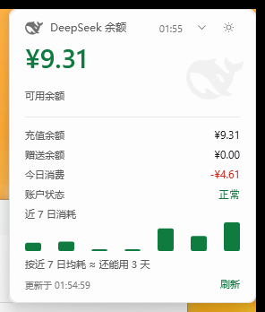
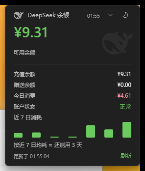
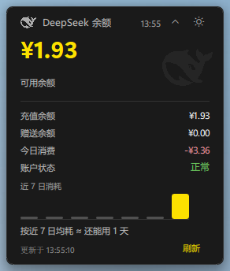
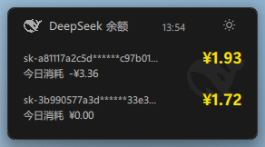
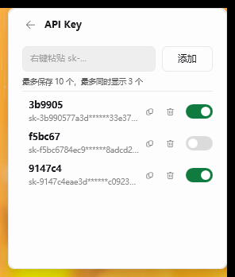

# DeepSeek 余额悬浮窗

一个用于实时显示 DeepSeek API 账户余额的 Windows 桌面悬浮窗，采用 WinUI 3 / Fluent Design 风格，支持系统云母（Mica）背板、亮暗主题切换、多 Key 管理与用量统计。

> 原生 C# + WPF 实现，单个约 106 KB 的 exe，无任何外部依赖；Windows 10 1903+ / 11 双击即用。

---

## 下载

[](https://github.com/K3huazhi/deepseek-balance-float/releases/latest)
[](https://github.com/K3huazhi/deepseek-balance-float/releases)

**一个版本，双击即用。**

| 版本 | 体积 | 依赖 | 说明 |
| --- | --- | --- | --- |
| **v1.2 原生版** | **106 KB** | 无（.NET Framework 4.8 系统自带） | 推荐 |
| v1.1 Python 版 | 55.8 MB / 126 KB | 内置运行时 / 需 Python | 已归档，不再更新 |

### v1.2 原生版（推荐）

**[⬇ DeepSeek-Balance-Float-v1.2.1.exe](https://github.com/K3huazhi/deepseek-balance-float/releases/download/v1.2.1/DeepSeek-Balance-Float-v1.2.1.exe)** · 106 KB

SHA256：`77f38af2702560623bfc1f5d1e6853df5ace68951a695554a5b523afd55b603f`

用 C# + WPF 重写，编译产物只有 106 KB。Windows 10 1903+ 与 Windows 11 自带 .NET Framework 4.8，
所以**不需要安装 Python，也不需要装任何运行时**，双击即用，启动不到 1 秒。
拖动窗口靠近屏幕边缘时会自动吸附对齐。

> 使用自签名证书（`CN=K3huazhi`）签名。该证书不受公共 CA 信任，未导入证书的机器上
> SmartScreen 仍可能提示「未知发布者」，点「更多信息 → 仍要运行」即可。

升级说明：Key 存在 Windows 凭据管理器、设置与统计存在注册表，
与 Python 版使用相同位置，**从旧版本升级不会丢失 Key、命名和历史消耗记录**。

历史版本见 [Releases](https://github.com/K3huazhi/deepseek-balance-float/releases)。

---

## 功能特性

### 界面
- **系统云母材质**：调用 DWM 的 Mica 背板（Windows 11），窗口透明无边框、圆角、隐藏系统描边
- **亮色 / 暗色 / 跟随系统**：一键切换，切换时带回波扩散的换肤动画
- **余额动效**：数字滚动计数，余额减少时抖动并飘出红色 `-¥0.01`
- **拖动定位**：拖动窗口任意位置移动，靠近屏幕边缘时自动吸附（12 px 内），位置自动记忆，多显示器各自吸附
- **可置顶、可开机自启**

### 数据
- **余额展示**：实时余额、可用状态、充值余额、赠送余额、今日消费
- **近 7 日消耗柱状图** + 按近期均耗估算的可用天数
- **多 Key 支持**：最多保存 10 个 API Key，最多同时显示 3 个
  - 显示 ≥ 2 个时自动切换为紧凑视图，只显示各 Key 的余额与今日消耗
- **Key 命名**：可为每个 Key 命名，不命名时默认取 `sk-` 之后的六位

### 安全
- API Key 保存在 **Windows 凭据管理器**（DPAPI 加密、按用户隔离），不写入任何文件
- 界面中已保存的 Key **隐藏中间六位**（如 `sk-a81117a2c5d******c97b01ceb0921c8`）
- 界面设置与用量统计存放在注册表 `HKCU\Software\DeepSeekBalance`，**不生成配置文件**
- 连点两下余额可立即刷新；右键菜单可管理 Key、切换主题、置顶、开机自启

---

## 截图

| 亮色主题 | 暗色主题 |
| --- | --- |
|  |  |

| 展开详情 | 多 Key 视图 | API Key 管理 |
| --- | --- | --- |
|  |  |  |

---

## 环境要求

- Windows 10 1903+ / Windows 11（x64）
- 无需安装任何运行时（.NET Framework 4.8 为系统组件）

---

## 运行

双击 `DeepSeek-Balance-Float.exe` 即可。首次启动没有 Key 时会弹出 **API Key 管理**窗口：

1. 复制你的 DeepSeek API Key（`sk-...`）
2. 在输入框中 **右键即可直接粘贴**
3. 回车或点「添加」保存

之后的 Key 管理可以从右键菜单进入。

> 建议把 exe 放在普通目录（桌面、D 盘等）。某些沙箱/同步盘目录会带低完整性标记，
> 这会让程序无法写入注册表。

---

## 使用说明

| 操作 | 说明 |
| --- | --- |
| 左键拖动 | 移动窗口，位置自动保存 |
| 双击余额 | 立即刷新 |
| 右键单击 | 打开菜单：刷新 / API Key 管理 / 主题 / 置顶 / 开机自启 / 退出 |
| 右上角 ⌄ / ⌃ | 展开或收起详情面板 |
| 右上角 ☀ / ☾ | 切换亮色 / 暗色 |
| 点 Key 名称 | 在底部改名条中重命名（Enter 保存，Esc 取消） |
| 拨动开关 | 控制该 Key 是否显示在悬浮窗（最多 3 个） |
| 垃圾桶图标 | 删除 Key（有二次确认） |

### 多 Key 显示规则

- 保存上限 **10 个**
- 同时显示上限 **3 个**，至少保留 **1 个**
- 显示数量 **≥ 2** 时，悬浮窗自动隐藏详情面板，只显示每个 Key 的「余额 + 今日消耗」

---

## 数据存储位置

| 数据 | 位置 |
| --- | --- |
| API Key（含名称、显示状态） | Windows 凭据管理器，目标名 `DeepSeekBalance:api_key` |
| 主题 / 位置 / 置顶 / 展开 / 刷新间隔 / 接口地址 / 用量统计 | 注册表 `HKCU\Software\DeepSeekBalance` |

程序运行期间 **不会在程序目录生成任何文件**。查看或清理凭据可在「控制面板 → 凭据管理器 → Windows 凭据」中操作。

默认请求地址为 `https://api.deepseek.com/user/balance`，如需修改可编辑注册表项 `url`。

---

## 从源码构建

原生版用系统自带的 `csc.exe` 编译，不需要安装 SDK、Visual Studio 或任何 NuGet 包：

```powershell
$bin = 'C:\Windows\Microsoft.NET\Framework64\v4.0.30319'
$wpf = Join-Path $bin 'WPF'
$refs = @(
  (Join-Path $wpf 'PresentationFramework.dll'),
  (Join-Path $wpf 'PresentationCore.dll'),
  (Join-Path $wpf 'WindowsBase.dll'),
  (Join-Path $bin 'System.Xaml.dll'),
  (Join-Path $bin 'System.Web.Extensions.dll'),
  (Join-Path $bin 'System.Core.dll')
) | ForEach-Object { "/r:$_" }

& "$bin\csc.exe" /nologo /target:winexe /optimize+ /codepage:65001 /platform:anycpu `
  /win32manifest:app.manifest /win32icon:icon.ico $refs `
  /out:DeepSeek-Balance-Float.exe core.cs program.cs ui_main.cs ui_keys.cs
```

产物就是单个约 106 KB 的 exe。

---

## 项目结构

```
native/
  core.cs          Win32 / DWM 云母 / 凭据管理器 / 注册表 / HTTP / 统计
  ui_main.cs       主窗口：卡片、详情、多 Key 视图、主题波纹、右键菜单
  ui_keys.cs       API Key 管理窗口
  program.cs       入口、单实例互斥、鲸鱼 SVG 路径
  app.manifest     PerMonitorV2 高 DPI + asInvoker

balance_float.py   v1.1 及更早的 Python 实现（已归档，保留作参考）
launcher.cs        v1.1 精简版启动器（已归档）
```

### v1.2 的技术选择

- **云母**：`DwmSetWindowAttribute(DWMWA_SYSTEMBACKDROP_TYPE, 2)` 配合
  `DwmExtendFrameIntoClientArea` 与透明合成目标；圆角用 `DWMWA_WINDOW_CORNER_PREFERENCE`
- **签名验证**：`MSIX` 不需要，直接 `Set-AuthenticodeSignature` 即可
- **主题波纹**：椭圆 `ScaleTransform` 动画从主题按钮位置扩散，文字颜色同步插值
- **Key 存储**：`CredReadW / CredWriteW`，与 Python 版同一目标名 `DeepSeekBalance:api_key`
- **开机自启**：写 `HKCU\Software\Microsoft\Windows\CurrentVersion\Run`，
  不用 Startup 目录的 bat（实测会被安全软件拦截）

---

## 注意事项

- 余额每 5 秒以上轮询一次（默认 3 秒，最小 5 秒），频繁刷新可能触发接口限流
- 统计的「今日消耗」由前后两次余额差推算，只在有消耗时增长
- 本程序会向 DeepSeek 官方接口发送请求，需要能访问 `api.deepseek.com`

---

## 许可证

[MIT](LICENSE)
