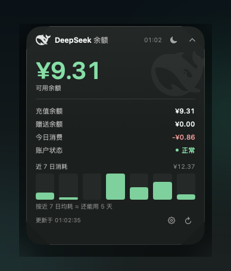
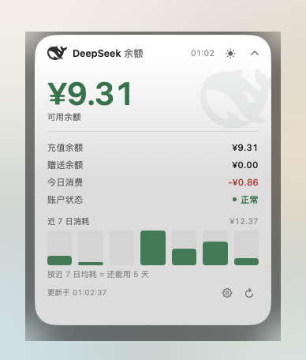
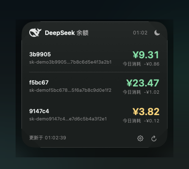
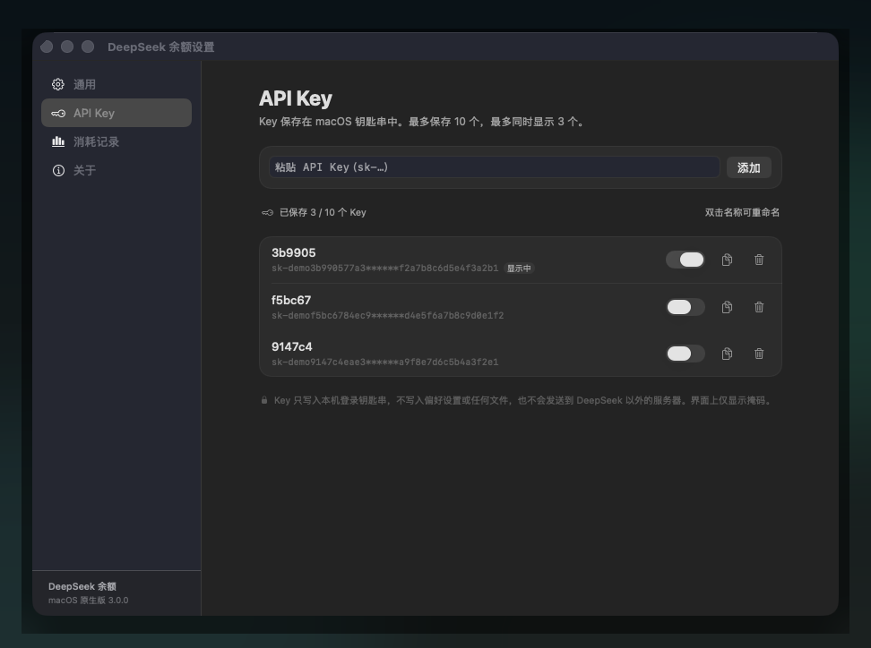
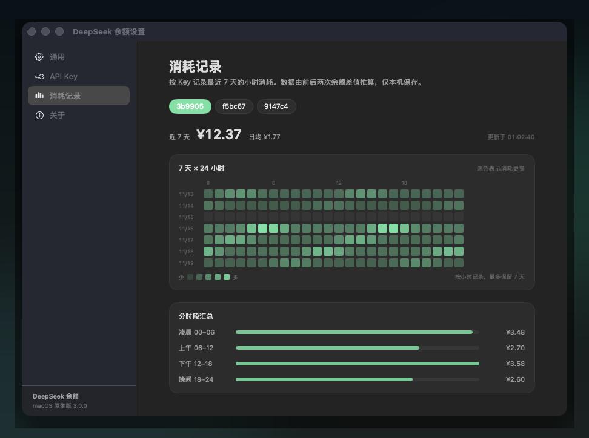
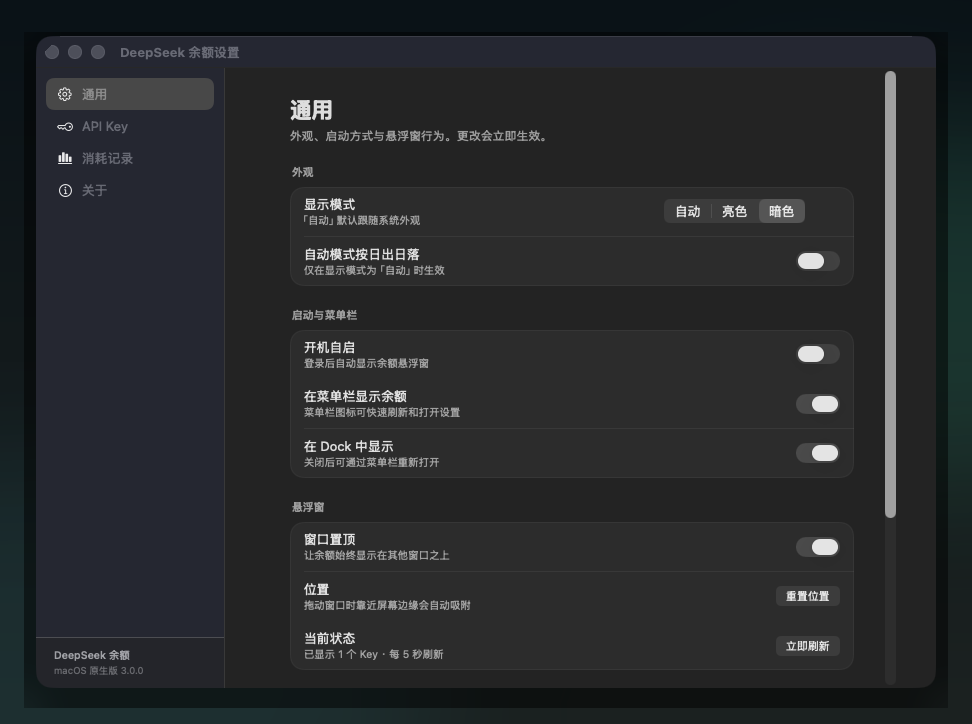
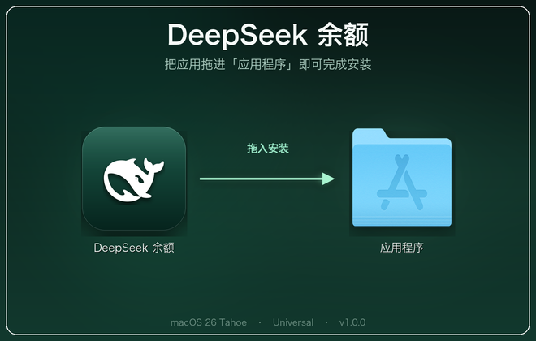

# DeepSeek 余额 · macOS 版 v1.0.0

为 **macOS Tahoe 26** 原生重制的 DeepSeek API 余额悬浮窗。界面使用 SwiftUI + Liquid Glass，
数据规则移植自 [K3huazhi/deepseek-balance-float](https://github.com/K3huazhi/deepseek-balance-float)
的 Windows 版；不是把 WPF 界面简单套壳，而是按 macOS 的窗口、菜单栏、钥匙串与设置窗口重新实现。

<p align="center">
  
  
</p>

| 多 Key 紧凑视图 | API Key 管理 |
| --- | --- |
|  |  |

| 消耗记录 | 通用设置 |
| --- | --- |
|  |  |

<p align="center">
  
</p>

---

## 功能

- **Liquid Glass 悬浮窗**：macOS 26 原生玻璃材质、连续圆角、细描边，自动适配亮色 / 暗色。
- **实时余额**：每 5 秒刷新；右键面板或按 `⌘R` 立即刷新；支持充值余额、赠送余额、今日消费、账户状态。
- **多 Key**：最多保存 10 个、同时显示 3 个；显示 ≥ 2 个时自动切换为紧凑列表。
- **消耗统计**：最近 7 天 × 24 小时热力图、四时段汇总、7 日均耗与预计可用天数，按 Key 分别记录。
- **菜单栏常驻**：菜单栏显示当前余额，可快速刷新、显示 / 隐藏悬浮窗、打开设置。
- **原生设置窗口**：通用、API Key、消耗记录、关于四个分区；原生侧边栏与控件。
- **钥匙串保存 Key**：只写入登录钥匙串，不生成明文配置文件；界面只显示掩码。
- **按 Key 记录**：统计写在 Application Support，日汇总保留 90 天，小时明细保留 7 天。
- **拖拽与吸附**：4 pt 起拖，靠近屏幕边缘 12 pt 吸附；按显示器记忆位置，多显示器可用。
- **外观模式**：亮色 / 暗色 / 自动；自动可跟随系统，也可按当地日出日落切换。
- **平台细节**：窗口置顶、开机自启、隐藏 Dock 图标、菜单栏菜单、Dock 右键菜单、减少透明度 / 减少动态效果适配、VoiceOver 标签。
- **无第三方依赖**：纯 SwiftUI + AppKit + Security + ServiceManagement，单一 `.app`，Universal Binary（Apple Silicon / Intel）。

---

## 系统要求

- macOS **26.0 Tahoe** 或更高版本
- Apple Silicon 或 Intel Mac
- 能访问 `https://api.deepseek.com`（或你自建的反向代理）

---

## 安装与首次使用

1. 从 [Releases](https://github.com/K3huazhi/deepseek-balance-float/releases) 下载 `macos-v1.0.0` 的 DMG（源仓库不提交二进制），把左侧的 **DeepSeek 余额.app** 拖到右侧「应用程序」文件夹（DMG 内有安装箭头与背景指引）。
2. 首次打开若提示「无法验证开发者」，在 Finder 中 **右键 → 打开**，或执行：
   ```bash
   xattr -dr com.apple.quarantine "/Applications/DeepSeek 余额.app"
   ```
3. 首次启动没有 Key 时会自动打开 **设置 → API Key**：
   - 粘贴 `sk-...`，点「添加」；
   - Key 会存入登录钥匙串；
   - 关闭设置窗口，悬浮窗开始显示余额。
4. 之后可从左上角鲸鱼、菜单栏图标、右键菜单或 `⌘,` 打开设置。

> 应用使用 **ad-hoc 临时签名**（没有 Apple Developer ID）。更新或重新构建后，macOS 可能弹出一次
> 「DeepSeek 余额想要使用您存储在钥匙串中的机密信息」，点 **始终允许** 即可。用同一个构建添加的 Key
> 不会反复弹窗。

---

## 操作

| 操作 | 效果 |
| --- | --- |
| 拖动面板 | 移动窗口；靠近屏幕边缘自动吸附 |
| 右键面板 | 立即刷新，同时弹出菜单 |
| 双击标题 | 展开 / 收起详情 |
| 点左上角鲸鱼 | 打开设置 |
| 右上角太阳 / 月亮 / 半圆 | 循环切换：亮色 → 暗色 → 自动 |
| 右上角箭头 | 展开 / 收起详情 |
| 菜单栏余额 | 刷新、显示 / 隐藏面板、设置、退出 |
| `⌘R` | 立即刷新 |
| `⌘,` | 打开设置 |
| `⌘⇧D` | 显示 / 隐藏悬浮窗 |
| `⌘E` | 展开 / 收起详情 |
| 多 Key 行 | 点击进入 API Key 管理 |

### 多 Key 规则

- 保存上限 **10 个**；
- 同时显示上限 **3 个**，至少保留 **1 个**；
- 显示数量 **≥ 2** 时，悬浮窗自动使用紧凑视图（名称、掩码、余额、今日消耗）。

### 设置项

- **通用**：显示模式、按日出日落自动切换、开机自启、菜单栏余额、Dock 图标、窗口置顶、重置位置、自定义接口地址、打开数据目录、清空统计。
- **API Key**：添加、重命名（双击名称）、复制完整 Key、删除（二次确认）、是否显示在悬浮窗。
- **消耗记录**：按 Key 切换、7 × 24 热力图、四时段汇总。
- **关于**：版本、上游项目、DeepSeek 开放平台、数据位置、许可证说明。

---

## 数据与隐私

| 数据 | 位置 |
| --- | --- |
| API Key | 登录钥匙串：服务 `com.k3huazhi.DeepSeekBalanceFloat`，账户 `api_key` |
| 界面设置 / 位置 / 主题 / 接口地址 | `~/Library/Preferences/com.k3huazhi.DeepSeekBalanceFloat.plist` |
| 消耗统计 | `~/Library/Application Support/DeepSeekBalanceFloat/stats.json` |

- Key 仅保存在本机钥匙串，不会写入程序目录，也不会发送到 DeepSeek 官方接口以外的服务器。
- 除余额接口外，应用不发起任何网络请求，不含分析、崩溃上报或自动更新。
- 默认接口：`https://api.deepseek.com/user/balance`，可在「设置 → 通用 → 高级」修改。
- 统计来自前后两次余额的差值，只在有实际消耗时增长；应用退出期间的消耗无法回溯。

---

## 从源码构建

需要 macOS 26 SDK 与 Xcode Command Line Tools（Swift 6.2+）。

DMG 安装界面的背景/箭头/图标布局由 Python 的 `dmgbuild` 生成，依赖已经声明在
[`scripts/requirements-build.txt`](scripts/requirements-build.txt)，仅构建期需要：

```bash
xcode-select --install

python3 -m venv .venv-build
.venv-build/bin/python -m pip install -r scripts/requirements-build.txt

PYTHON=.venv-build/bin/python ./scripts/build.sh
```

脚本会用 `swiftc` 分别编译 `arm64` 与 `x86_64`，`lipo` 成 Universal Binary，然后：

- 生成 `dist/DeepSeek 余额.app`
- 运行内置自检
- ad-hoc 签名
- 打包 `dist/DeepSeek-Balance-Float-macos-v1.0.0-universal.zip`
- 用 `dmgbuild` 生成带背景、安装箭头、卷图标与固定图标位置的安装 DMG
- 给 DMG 文件本身写入应用图标，Finder 中一眼可辨

如果未安装 `dmgbuild`，`build.sh` 会回退为普通 DMG，并打印安装依赖的命令；不会在构建时自动联网安装。

开发时也可以直接用 SwiftPM：

```bash
swift build
./.build/debug/DeepSeekBalanceFloat
```

### 自检与演示模式

```bash
# 数据解析、日出日落、统计、钥匙串等自检
./.build/debug/DeepSeekBalanceFloat --self-test

# 用假数据预览界面（不读写钥匙串）
DSB_DEMO=1 ./.build/debug/DeepSeekBalanceFloat
```

---

## 项目结构

```
Sources/DeepSeekBalanceFloat/
  Main.swift              程序入口、自检开关
  AppDelegate.swift       主菜单、生命周期、Dock / 菜单栏联动
  AppModel.swift          余额刷新、Key 管理、演示数据
  PanelController.swift   悬浮面板、位置记忆、吸附、右键刷新
  SettingsWindowController.swift  原生设置窗口
  PanelView.swift         悬浮窗（余额、详情、多 Key、空状态）
  SettingsRootView.swift  设置窗口骨架
  GeneralSettingsView.swift / KeysSettingsView.swift / UsageSettingsView.swift / AboutSettingsView.swift
  StatusBarController.swift       菜单栏余额与菜单
  Components.swift        Liquid Glass 背景、图标按钮、动画数字、鲸鱼图标
  Palette.swift           语义色
  Models.swift            Key / 余额 / 掩码 / 指纹
  Stats.swift             7 × 24 统计与持久化
  SunTimes.swift          日出日落
  ApiClient.swift         DeepSeek 接口与错误映射
  Keychain.swift          钥匙串读写
  LoginItem.swift         SMAppService + LaunchAgent 兜底
  WindowSnapper.swift     边缘吸附
  WhaleShape.swift        由官方鲸鱼 SVG path 生成的 SwiftUI Shape

resources/                Info.plist、AppIcon.icns、图标母版、DMG 背景
resources/dmg/            DMG 背景图（1x / 2x）
scripts/build.sh          通用二进制打包脚本
scripts/make_dmg.py       带背景/箭头/图标布局的 DMG 制作
scripts/requirements-build.txt  dmgbuild / ds_store / mac_alias（仅构建期）
scripts/sign_and_notarize.sh    Developer ID 签名、公证与装订（可选）
docs/                     README 截图
```

Windows 版源码仍在仓库根目录（`../native/`、`../balance_float.py`），macOS 目录不再复制一份，避免体积翻倍和不同步。

---

## 与 Windows 版的对应关系

| Windows 版 | macOS 版 |
| --- | --- |
| WPF + DWM Mica | SwiftUI + Liquid Glass（`glassEffect`） |
| 单窗口内切换主界面 / 设置 / Key / 统计 | 悬浮面板 + 独立原生设置窗口（`⌘,`） |
| 水波纹、Key 页横向滑动 | 原生高度动画、窗口缩放与系统转场 |
| Windows 凭据管理器（DPAPI） | macOS 登录钥匙串（Security.framework） |
| 注册表 `HKCU\Software\DeepSeekBalance` | `UserDefaults` + Application Support |
| `.NET Framework 4.8` 单 exe | Universal `.app`，无运行时依赖 |
| 注册表 Run 键 / Startup | `SMAppService`，失败时回退 LaunchAgent |
| 5 秒刷新、7 × 24 热力图、多 Key 规则、余额色阶 | 完全保留同一套数据规则 |

**不兼容**：Windows 版的 Key、统计与设置无法直接迁移到 macOS（存储机制不同）。在 macOS 版中重新添加 Key 即可；
历史消耗从首次运行开始累计。

---

## 正式签名与公证（可选）

当前 `dist/` 里的产物是 **ad-hoc 临时签名**。这并不代表不能签 Apple 的证书，而是
**Developer ID 证书必须由开发者本人的 Apple Developer Program 账号签发**（99 美元/年），
本机钥匙串目前没有任何可用签名身份（`security find-identity -v -p codesigning` 返回 0 个），
因此无法在当前环境直接生成受 Gatekeeper 信任的签名。

如果你有开发者账号，按下面三步即可得到「双击直接打开、无未知开发者提示」的正式版本：

1. **安装 Developer ID Application 证书**
   - developer.apple.com → Certificates → + → **Developer ID Application**；
   - 下载 `.cer` 并双击安装到登录钥匙串（私钥需在生成 CSR 的 Mac 上）；
   - 验证：
     ```bash
     security find-identity -v -p codesigning
     ```

2. **保存公证凭据**（App 专用密码在 appleid.apple.com 生成，不会写进仓库）
   ```bash
   xcrun notarytool store-credentials "DSB-notary" \
     --apple-id "you@example.com" --team-id "TEAMID"
   ```

3. **签名 + 公证 + 装订**
   ```bash
   NOTARY_PROFILE=DSB-notary ./scripts/sign_and_notarize.sh
   ```
   或让构建脚本自动完成：
   ```bash
   NOTARY_PROFILE=DSB-notary ./scripts/build.sh
   ```

脚本会依次执行：

- `codesign --options runtime --timestamp` 使用 Developer ID 签名 App；
- 把 App 打成临时 zip 提交公证，通过后 `stapler staple`；
- 用装订后的 App 重新生成 zip；
- 生成带背景的 DMG，签名 DMG 并提交公证，通过后 `stapler staple`；
- 最后用 `spctl` 检查 App 与 DMG 的 Gatekeeper 评估结果。

也支持 App Store Connect API Key：

```bash
APPLE_API_KEY=/path/AuthKey_XXXX.p8 APPLE_API_KEY_ID=XXXX APPLE_API_ISSUER=xxxx-... \
  ./scripts/sign_and_notarize.sh
```

> 不要把 `.p12`、App 专用密码或 API Key 发到聊天/仓库里；直接装在本机钥匙串或环境变量中即可。
> 没有付费开发者账号时，自签名证书只能稳定钥匙串 ACL，**不能让 Gatekeeper 信任**，仍会提示未知开发者，
> 因此不建议作为公开分发方案。

## 验证环境

本版本的实际构建/验证环境：

| 项目 | 版本 |
| --- | --- |
| macOS | 26.7.3（build **25G342**） |
| Xcode | 未安装完整 Xcode |
| Command Line Tools | **26.6.0.0.1781586589** |
| Swift | 6.3.3（swiftlang-6.3.3.1.3） |
| macOS SDK | 26.5 |
| 构建目标 | macOS 26.0，arm64 + x86_64 Universal |
| 自检 | 30 项全部通过 |

构建产物为 **ad-hoc 临时签名，未做 Apple 公证**；首次打开需要右键「打开」，更新后可能出现一次钥匙串授权。
正式签名与公证流程见下方「正式签名与公证（可选）」，当前版本没有执行该流程。

## 已知限制

- 默认产物使用 ad-hoc 签名，未做 Apple 公证；首次打开需右键「打开」，更新后可能出现一次钥匙串授权。
  如已配置 Developer ID 与公证凭据，运行 `scripts/sign_and_notarize.sh` 即可得到 Gatekeeper 直接放行的版本。
- 没有 Apple Developer ID 时，无法使用 `SMAppService` 的场景会自动回退到 `~/Library/LaunchAgents` 登录项。
- 余额接口只支持 DeepSeek 官方 `balance_infos` 结构；自建代理需保持同样返回格式。
- 统计依赖应用持续运行；睡眠 / 退出期间的消费不会补记。
- 应用为单实例；重复打开会激活已有实例。
- 如果移动了应用位置，请在设置中关闭再开启一次「开机自启」，让登录项指向新路径。

---

## 许可证

本项目代码以 **MIT** 许可证发布，见 [LICENSE](LICENSE)。Windows 版源码位于仓库根目录
（`native/`、`balance_float.py` 等），同样使用 MIT 许可证（版权归 DeepSeek Balance Float contributors）。

DeepSeek、DeepSeek 鲸鱼标志是杭州深度求索人工智能基础技术研究有限公司的商标。
本应用是非官方客户端，与 DeepSeek 官方无隶属关系。

---

## English

A native macOS 26 (Tahoe) remake of the DeepSeek balance floating widget, extracted from the
Windows WPF project [K3huazhi/deepseek-balance-float](https://github.com/K3huazhi/deepseek-balance-float).
Built with SwiftUI and Liquid Glass, with a menu bar extra, Keychain-backed API keys, a native settings
window, and 7×24 usage heatmaps. Universal binary for Apple Silicon and Intel. MIT licensed; not
affiliated with DeepSeek.
